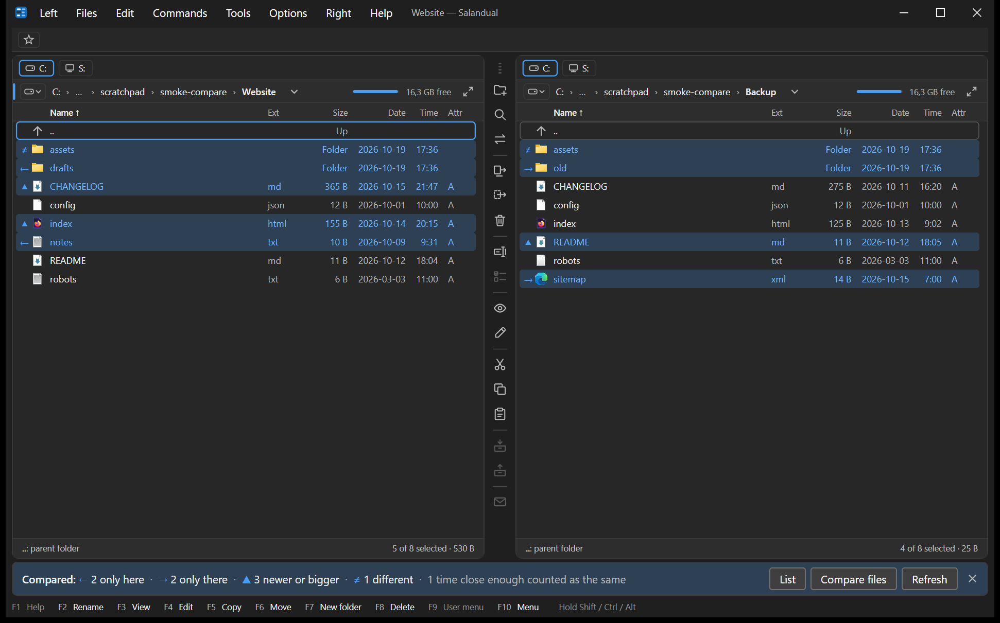

<!--
  Salandual - a keyboard-first, dual-pane file manager for Windows.
  Project : https://github.com/TomEvin/salandual
  Author  : TomEvin (https://github.com/TomEvin)
  Copyright (C) 2026 TomEvin
  License : GNU General Public License v3 or later (GPL-3.0-or-later). The full text is in the LICENSE file of the project.
  SPDX-License-Identifier: GPL-3.0-or-later
  Source  : README.md
-->
<p align="center">
  
</p>

<h1 align="center">Salandual</h1>

<p align="center">
  <b>A keyboard-first, dual-pane file manager for Windows.</b><br>
  It works the way Altap Salamander and Open Salamander do (same keys, same flow) and adds full Unicode, long paths, light and dark themes, modern image formats and a modern interface.
</p>

<p align="center">
  <a href="https://github.com/TomEvin/salandual/releases"></a>
  <a href="LICENSE"></a>
  
  
</p>

<p align="center">
  
</p>

> **Status: v0.1, the first release.** Salandual is complete enough for everyday file work, but it is young and some Salamander features are not built yet (see [What is not in v0.1](#what-is-not-in-v01)). Expect rough edges, and please report them.
>

>[!IMPORTANT]
>I used and loved **Altap Salamnder** so much, I was not able to find replacement for years. My often used function broke after some time or just not supported the new formats. I tried many alternatives, none them was what I wanted. None of them provided the "Salamander feeling".
>I planned many times to develop my own filemanager, but the investigation went always too long. Now, since AI is very popular and able to do great things, I started this as a learning project with AI-driven development.

>[!CAUTION]
>**What to keep in mind**
>
>- AI-written code can be wrong in ways that tests and checks do not catch. v0.1 has not had an independent security review; the project's own list of security rules is checked in each step, and a full review against it is still to do. Keep backups, and until you trust it, try Move, Delete and overwrite on copies of your files first.
>- Open Salamander's published help text and key tables were the functional reference. No code from [Open Salamander](https://github.com/OpenSalamander/salamander) or [Samandarin](https://github.com/KRtkovo-eu-AI/salamander) is in `src`, see [THIRD-PARTY-NOTICES.md](THIRD-PARTY-NOTICES.md).
>- Please report what you find, see [Reporting problems and ideas](#reporting-problems-and-ideas).
>

## Why Salandual

Salamander users keep their muscle memory: `F5` copies, `F6` moves, `F3` views, `F4` edits, `Alt+F7` searches, `Ctrl+F10` compares folders. Salandual keeps that map as its default and builds it as new code on a current stack (C# 14, .NET 10, Avalonia 12), so it handles what an older 32-bit program struggles with: Unicode names in any script, paths over 260 characters, high-DPI screens, dark mode, AVIF, WebP, HEIC, JPEG XL and camera RAW pictures.

If you prefer Total Commander's keys, choose that key map in the first-start wizard or later in Options. Keys for features Salandual does not have yet stay unassigned instead of being silently given to something else.

## What it does

### Panels and navigation
- Two panels with a draggable splitter, a breadcrumb directory line, a header, an information line and an F-key bar that relabels for `Shift`, `Ctrl` and `Alt`.
- A custom-drawn list that stays smooth in folders with 100,000 entries; sorting is locale- and number-aware (`file2` before `file10`).
- Quick search (`/ \ <` wildcards), selection by mask, extension or name (`Space`, `Insert`, numeric `+ - *`, `Ctrl+A`, `Ctrl+W` to restore), hidden files (`Ctrl+H`), folder sizes on `Space`.
- A drive strip and drive menu (`Alt+F1` / `Alt+F2`) with labels, free space and a meter; **Drive information** (`Ctrl+F1`) with file system, SSD or HDD, cluster size and a rename.
- 30 **hot paths** (`Ctrl+1…0`, `Shift+F9` for the list) with a bar; *Change directory* (`Shift+F7`, `Ctrl+G`) with completion and history; per-panel working directories (`Alt+F12`); back and forward per panel; both panels' folders restored at the next start.
- Shell icons loaded in the background, a folder watcher that refreshes the list and keeps your place.

### File operations
- **Copy, Move, Delete, New folder, Quick rename, Duplicate** (`F5`, `F6`, `F8`, `F7`, `F2`, `Alt+Shift+D`), each checked before it starts: free space, files over 4 GB for FAT32, paths too long, a write-protected target, copying a file onto itself.
- A **job queue** that runs jobs on different disks in parallel and on the same disk one after another, with an operations panel: speed graph, pause, resume, cancel, a speed limit you can change while it runs, a queue you can reorder, and error cards that name the program holding a locked file.
- A conflict dialog that shows both files with the newer and the larger one marked, a "do the same for the rest" choice, and a Minimize button that moves the question to the operations panel.
- The Recycle Bin by default, `Shift+Del` for permanent deletion with Windows' warning, long paths, alternate data streams, timestamps and attributes kept, optional verify after copy. A move to another drive removes the original only after its copy has succeeded.
- Explorer-compatible clipboard (`Ctrl+C`, `Ctrl+X`, `Ctrl+V`), drag and drop in both directions with Explorer, a right-button drag menu, the Windows context menu inside a quick menu of Salandual's own commands, and a Properties dialog with Signature, Security and Previous versions.
- *When the queue is done:* nothing, close, lock, sleep, hibernate or shut down, with a 60-second countdown you can cancel. Taskbar progress and a notification when a long job ends in the background.

### Viewers (`F3`)
- **Text and hex** viewer that streams the file, so a multi-gigabyte file opens at once. Encodings, wrap, line numbers, find (text, regular expression, hex bytes), go to, selection and save selection, next and previous file with `Space` and `Backspace`.
- Colours for JSON, YAML, XML, HTML, CSS, JavaScript and Markdown, and a **Tree** view for JSON, JSON Lines, YAML and XML.
- **Markdown** and **Jupyter notebooks** shown rendered (a notebook is never run); **HTML** pages with their own look and a switch for scripts.
- **Images:** the usual formats plus AVIF, WebP, HEIC, JPEG XL, camera RAW, PSD, SVG, TGA and DDS. Fit, width and 1:1 zoom up to 6400 %, pan, rotate, mirror, full screen, neighbours decoded ahead, and photo information (EXIF, IPTC, XMP, GPS, colour profile).
- **Media files:** the information MediaInfo reads (streams, codecs, bit rates, HDR, chapters, tags, cover art). There is no audio or video playback.
- A mask table chooses the viewer for each kind of file; `Alt+F3` and `Ctrl+Shift+F3` pick another.

### Editor (`F4`)
- A built-in editor for text, JSON, YAML, XML, Markdown and any other text file, with the viewer's colours and fold markers.
- JSON, YAML and XML are checked while you type, with the place marked and a problems line; Format, Minify, Sort keys and Comment line.
- Find and replace with regular expression pieces, go to line, encodings, indentation and line endings from the status line.
- A **live preview** (`F6`) for Markdown, notebooks, SVG and HTML.
- Saving writes a temporary file and then swaps it in, keeps a `.bak` on the first save, and asks what to do when another program changed the file meanwhile.
- Any extension can be given an external program instead (`Shift+F4` makes a new file, `Ctrl+Shift+F4` edits with another program).

### Search and compare
- **Search** (`Alt+F7`, `Ctrl+F`): names with masks, several texts as rows (*contains* or *doesn't contain*, all or any, as text, regular expression or hex, in chosen encodings), size, dates, attributes, depth, folders to skip, inside ZIP files. Results show the matching line; saved searches; *Show in a panel*.
- **Find duplicates** (`Alt+Shift+F7`) by name, size or content.
- **Compare directories** (`Ctrl+F10`) by size, time, attributes or content, with the differences marked in both panels and a list of them you can filter.
- **File comparator** (`Ctrl+Shift+C`): text side by side in code colours, binary as hex, only the differences, ignore spacing or case, copy changes across with arrows, undo, save. WinMerge, Beyond Compare, VS Code or any program can be used instead.
- **Make file list** (`Ctrl+M`) with your own line templates, and **Occupied space** (`Alt+F10`, `Ctrl+Q`) with a chart that counts real disk clusters, compression and cloud files.

### Look, settings and keys
- **Themes:** Salandual Light and Dark, Salamander Classic, high contrast, several greys, Dracula, Nord, Gruvbox, Catppuccin, Tokyo Night, GitHub and VS Code's own themes. Make your own from any theme, import a VS Code theme or a `.saldtheme` file, follow Windows' light and dark mode or your own schedule, pick an accent colour and a background picture.
- Menus in the title bar, on their own row or behind a button; a window title built from a template; row height, fonts, size units, date and 12- or 24-hour time formats.
- **Options** with a search across every page; export, import and reset of your settings (`.saldset`), shown part by part before anything changes, with Undo.
- Key maps for Salamander and Total Commander, a cheat sheet, and *Which command has a key?*
- A first-start wizard (also under **Help › First steps**).

### Careful with your files
- File names and contents are treated as untrusted. Programs start by full path with an argument list, never through a command shell.
- Delete and Move never follow a folder link into its target; viewing never runs anything.
- A settings file that is broken, held open by another program or from a newer version is never overwritten: it is moved aside or left alone, and Salandual says so at start.

## What is not in v0.1

These are planned and some already appear greyed out in the menus with a note:

- **Archives:** browsing, packing and unpacking (ZIP, 7z, RAR, TAR and more), apart from searching inside ZIP files.
- **Tabs**, the **user menu** (`F9`) and the **command line**, quick open and a key-map editor (the key map is read-only for now), changing attributes, network places, Windows shell folders as places.
- **Remote:** FTP, FTPS, SFTP and SCP. **Plugins.**
- Other languages: the interface is English only; Hungarian is the first translation planned.
- Importing settings from Altap Salamander, an installer and automatic updates.
- Playback of audio and video; PDF, EPS and ICNS previews; animated images (the first frame is shown).
- Windows on Arm, Linux and macOS builds.

## Install

1. Download `Salandual-0.1-win-x64.zip` from the [Releases](https://github.com/TomEvin/salandual/releases) page.
2. Before unzipping, right-click the zip, choose **Properties** and tick **Unblock** if it is there, so Windows does not flag every file inside.
3. Unzip it anywhere you like. It makes a `Salandual-0.1` folder; run `salandual.exe` inside it. There is no installer and no .NET installation is needed; the build is self-contained.

**Requirements:** Windows 11, 64-bit (x64). Windows 10 22H2 may work but is not tested.

**Windows may warn about the download.** v0.1 is not code-signed yet. If SmartScreen says *Windows protected your PC*, choose **More info › Run anyway**.

**To remove it,** delete the folder and, if you want your settings gone too, `%APPDATA%\Salandual`.

### Command line

| Parameter | Meaning |
|---|---|
| `-L <folder>` | open this folder in the left panel |
| `-R <folder>` | open this folder in the right panel |
| `-A <folder>` | open this folder in the active panel (ignored when `-L` or `-R` is given) |
| `-P 1`, `-P 2` | make the left or the right panel the active one |

A folder path on its own counts as `-A`, so dropping a folder on the icon opens it. By default only one Salandual runs at a time; a second start hands its folders to the running window.

## Your data and privacy

| What | Where |
|---|---|
| Settings, session, history, logs | `%APPDATA%\Salandual` |
| Rendered pages' browser profile | `%LOCALAPPDATA%\Salandual\WebView2` |
| Short-lived files (a file list shown in the viewer, a page's copy) | `%TEMP%\Salandual`, removed when Salandual closes |

**Portable mode:** put an empty file named `portable.flag` next to `salandual.exe`. Settings, history and logs then live in a `Data` folder beside it instead of `%APPDATA%`.

**Nothing is sent anywhere by Salandual.** There is no telemetry, no crash report upload and no update check. What can touch the network is what you open: pages shown in the Markdown, notebook and HTML viewers can load pictures and other content from the web, and *Show on map* opens your browser. Options › Viewers has switches for both, and scripts in HTML pages can be turned off.

## Build from source

You need Windows 11 (x64) and the [.NET SDK](https://dotnet.microsoft.com/download/dotnet/10.0) 10.0.400 or newer (`global.json` pins it, with roll-forward to newer feature bands). Visual Studio is not required.

```powershell
git clone https://github.com/TomEvin/salandual.git
cd salandual

dotnet build Salandual.slnx
dotnet run --project src/Salandual.App

# the same build as the release: self-contained, ReadyToRun, trimmed
dotnet publish src/Salandual.App -p:PublishProfile=win-x64
# output: artifacts\publish\win-x64\salandual.exe
```

The build treats warnings as errors, so a clean build is the baseline.

### Tests

```powershell
dotnet test Salandual.slnx
```

- `Salandual.Core.Tests` has the pure logic (masks, sorting, selection, settings, search, compare, key maps).
- `Salandual.Platform.Windows.Tests` runs the copy engine and file system code on real temporary folders: Unicode and 260+ character names, conflicts, locked files, cancelling, junctions, alternate data streams.
- `Salandual.Imaging.Tests` covers picture decoding, photo information and media information.
- `Salandual.App.Tests` drives the real windows with Avalonia's headless platform. These take several minutes.

### Project layout

| Path | Contents |
|---|---|
| `src/Salandual.Core` | Pure .NET with no UI and no Win32: file system model, listing, selection, operations, commands and key maps, compare, search, viewer logic, settings |
| `src/Salandual.Platform.Windows` | Win32 and COM: local file system, copy engine, Recycle Bin, shell menus, drives |
| `src/Salandual.Imaging` | Image decoder chain and photo and media information |
| `src/Salandual.Archives` | Archives as file systems (an empty placeholder: the feature is not in v0.1) |
| `src/Salandual.App` | The Avalonia application, `salandual.exe` |
| `tests/` | xUnit tests for Core, Platform.Windows, Imaging and the App |

## Roadmap

Plans, not promises, and the order can change:

1. **0.5, Salamander parity:** archives, user menu and command line, more panel views and filters, tabs, quick open with a key-map editor, movable bars, Hungarian, cloud folders, several monitors, touch and pen, import from Altap Salamander.
2. **0.8, tools:** FTP, FTPS, SFTP and SCP, checksums, batch rename, a disk space view, folder synchronization, a preview panel, Office documents in the viewer, and a plugin API.
3. **1.0:** an installer, automatic updates from GitHub Releases, code signing if it can be arranged, and a user manual.
4. **After 1.0:** a native Windows on Arm build, then Linux and macOS.

## Reporting problems and ideas

Please open an [issue](https://github.com/TomEvin/salandual/issues). Say what you did, what you expected and what happened, your Windows version and Salandual's version (turn on *Version in the title* in Options › Layout › Title bar and menus). Screenshots help; **leave out file names and paths you would not post publicly.** For a larger change, open an issue first so we can agree on it before you spend time on a pull request.

**Security problems:** please do not post them in a public issue. Use the repository's **Security** tab and choose **Report a vulnerability**, so the report stays private until there is a fix.

## License and credits

Salandual is free software under the **GNU General Public License v3 or later**, see [LICENSE](LICENSE). Every source file carries an SPDX header. The components it uses, with their licenses, are listed in [THIRD-PARTY-NOTICES.md](THIRD-PARTY-NOTICES.md).

Thanks to the **[Open Salamander](https://github.com/OpenSalamander/salamander)** authors and to Altap, whose program and published help describe the way of working Salandual follows, to the authors of **[Samandarin](https://github.com/KRtkovo-eu-AI/salamander)**, the fork of Open Salamander whose key list and changelog I also used as a reference, and to the Avalonia, .NET, ImageMagick, MediaInfo and AvaloniaEdit projects and the others listed in the notices.

Salandual is an independent project. It is not affiliated with ALTAP or the Open Salamander project. "Salamander" is used only to describe compatibility.
